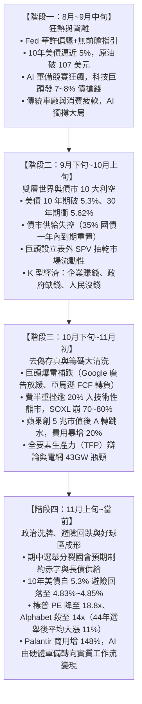

# 財經週報學習總綱與波克夏投資決策知識庫 (2026.08 - 2026.11)

> **建立時間**：2026-11-06  
> **最新定期研讀更新**：2026-11-09 17:05 (每週財經週報學習與價值投資知識庫定期研讀更新)  
> **核心使命**：系統化梳理本專案所有財經週報之宏觀週期演變、產業結構性矛盾、微觀企業財務真實數據，並深度融合頂尖價值投資者（Warren Buffett & Charlie Munger）的決策體系與安全邊際原則，形成高精準度、可落地的投資決策體系。

---

## 壹、 全景宏觀週期演變圖譜（2026.08 ～ 2026.11）

回顧專案內 8 份跨越三個多月的深度報告，全球資本市場經歷了一場教科書級別的「流動性擠壓、預期膨脹、巨頭分化、去槓桿清洗、乃至長線價值好球區成形」的完整週期：



---

## 貳、 本專案週報揭示的「五大金融市場核心底層真相」

### 1. 貨幣與財政的劇烈衝突：「央行收水、財政部放水、企業搶錢」
- **聯準會體制質變**：主席華許（Warsh）摒棄過去十餘年的「前瞻指引（Forward Guidance）」，採取逐次數據決定，利率區間定錨在 3.75%~4.00%。高利率停留更久（Higher for Longer）確立。
- **財政部天量發債赤字**：美國聯邦債務破 40 兆美元，其中高達 35% 必須在一年內以 >5% 利率天量換發；財政部長必森特試圖以 9,540 億美元 TGA 資金回購長債進行「財政版 QE」，造成政策矛盾。
- **企業發債排擠效應**：微軟、Google、Meta 等巨頭大舉發行 7%~8% 高息投資級公司債，甚至動用表外 SPV 避開資產負債表。私人資金被高息吸走，國債買盤枯竭，直接把全球基準借貸成本定錨在 5%~5.6% 高位。
- **期中選舉制衡預期**：在分裂國會（Divided Government）預期下，極端財政擴張法案難以通過，對財政赤字與長債發行產生實質緊箍咒，為長端債市帶來短暫緩解契機。

### 2. 生產力革命的殘酷辯論：「勞動生產力狂飆 vs. 全要素生產力（TFP）停滯」
- **勞動生產力確實爆發**：Alphabet 與微軟在員工零成長甚至負成長情況下，營收指數飆至 145~170，人事成本顯著節省；AI 每百萬 Token 推論成本暴跌 54% 至 0.95 美元，每週 Token 消耗量突破 50 兆個（增長逾 25 倍）。
- **實質落地典範（Palantir）**：商用營收年暴增 148%（達 9.84 億美元）首度超越政府業務，淨留存率（NDR）高達 165%，證實深入企業工作流與用量計費（Usage-based）能將 AI 轉化為真實爆炸性現金流。
- **TFP 趨近於零的資本陷阱**：企業省下的薪水，全數甚至超額貼補進昂貴的 GPU 採購、電費與資料中心折舊。每年需要覆蓋 2,700 億美元的硬體折舊，前 6 大巨頭每年必須創造至少 1,640 億美元的營業利潤。
- **實體電網的物理死線**：全美資料中心規劃用電容量達 386GW（為現行的 6.2 倍）。2026 年缺電 15GW，到 2028 年缺口擴大至 43GW。軟體 Agent Token 消耗狂飆，但實體世界的電力與變壓器跟不上，引發商業化進程嚴苛考驗。

### 3. 「雙層世界」的極端撕裂（K 型分化）
- **企業賺大錢**：極少數 AI 晶片與雲端巨頭包辦整體指數 67% 以上的獲利增長，壟斷地位牢不可破。
- **政府大缺錢**：背負 20 多年來最昂貴的發債成本，美債遭亞洲盟友（韓日台）大舉減持，法國赤字破 5%，財政走鋼索。
- **人民變沒錢**：美國 30 年期房貸破 7.4%、柴油每加侖維持在 6 美元以上高位、個人儲蓄率跌至 4.1%。全美 87% 股票資產集中在前 10% 富人手裡，廣大中產實質購買力連續負成長，傳統車廠（福斯、BMW、保時捷）與奢侈品巨頭集體暴跌裁員。

### 4. 台灣在世紀大局中的「超額紅利」與「內部痛點」
- **硬體獨霸**：通吃全球 AI 伺服器（GB200/GB300）與先進製程（台積電 2 奈米、CoWoS、CPO），全年 GDP 上修至 11.48%，外銷訂單突破 1,029 億美元，人均淨金融資產達 594 萬台幣（全球第五）。
- **游資極度充沛**：超額儲蓄高達 8.46 兆台幣，新竹 New Rich 將游資瘋狂注入股市，高股息 ETF 與內資存股族買盤在年線上方展現極強抗震護城河，兩天硬抗外資單月提款近 6,000 億台幣。
- **結構性斷層**：薪資中位數（4.6~4.8 萬）追不上 GDP 噴發速度；高科技抽乾青年勞動力導致全台大缺工；電價補貼掩蓋真實通膨；壽險業面臨海外 6,960 億美元資產「台幣負債、美元資產」的幣別錯配隱患。

### 5. 市場籌碼與末跌段訊號
- **廣度嚴重惡化後的「巨頭補跌」**：先是 91% 個股先行回撤、半導體多數腰斬，最後輪到 Alphabet、英特爾、亞馬遜等巨頭財報爆雷補跌，象徵末跌段籌碼全面清洗。
- **槓桿資金斷頭出清**：3 倍槓桿費半 ETF（SOXL）市值崩跌 70%~80%，散戶交易比重降至 8.8%（散戶全面離場，浮額沉澱）。
- **歷史期中選舉定律**：依據歷史 44 年、12 次美國期中選舉統計，選後三個月美股平均大漲 11%，配合估值出清，標普 PE 回落至 18.8 倍、輝達降至 29 倍，非對稱高賠率窗口大開。

---

## 參、 頂尖價值投資決策體系（Buffett-Munger System）深度解析

站在華倫·巴菲特（Warren Buffett）與查理·蒙格（Charlie Munger）的「安全邊際原則」與「資本配置策略」視角，如何解讀本專案的宏觀現實？

| 頂尖價值投資核心原則 | 週報案例映射與警示 | 專業精準解讀與實戰操作指引 |
| :--- | :--- | :--- |
| **1. 實質盈餘（Owner Earnings）** | • 亞馬遜 12 個月自由現金流轉為負 423 億美元<br>• 甲骨文負債 1,560 億美元急發 200 億股債<br>• 新創公司發行 15%~16.6% 垃圾債融資維持租賃 | 絕不為「缺乏真實造血功能」的企業買單。價值投資最痛恨把資本支出偽裝成成長的商業模式。**必須剔除燒錢且自由現金流為負的投機標的**，嚴格聚焦於有高 ROIC、不需要依賴外部借債就能自我繁衍資金的企業。 |
| **2. 護城河與定價權（Pricing Power）** | • 蘋果第三季毛利率達 47.9%，觸控 MacBook Pro 敢開價 2,899 美元<br>• 鎧俠 NAND Flash 漲價幅度自 70% 驟降至 25%<br>• Marvell 溢價收購 Lumentum 引爆雙輸重挫 | 在通膨黏性與原物料高漲時，**定價權是唯一的救生圈**。Apple 擁有無可取代的心理份額與生態系；相反地，缺乏護城河的商品化零組件或盲目進行稀釋性併購的公司，其利潤會被瞬間吞噬。 |
| **3. 安全邊際（Margin of Safety）** | • 標普前瞻本益比從高檔 23 倍壓縮至 18.8 倍<br>• 輝達前瞻本益比降至 29 倍<br>• Alphabet 前瞻本益比跌至 14 倍安全邊際低檔 | 過去本益比 35~40 倍時沒有安全邊際；但在費半崩入技術性熊市（-20%）、市場廣度出清、巨頭前瞻 PE 被過度懲罰至 14~18 倍時，**「市場先生」已經把大部分的悲觀預期扣除**，安全邊際開始實質顯現。 |
| **4. 現金儲備與好球區（Patience & Float）** | • 美債殖利率 4.83%~5.3%，國庫券具備 4.8%~5% 無風險收益<br>• 散戶在 SOXL 暴跌 80% 時遭斷頭踩踏 | 永遠不要用融資槓桿賭博。持有高利率短天期國庫券（T-Bills）不是浪費時間，而是在**領取 5% 保底利息的同時，耐心等待暴跌斷頭後的絕佳擊球機會（Fat Pitch）**。 |
| **5. 逆向思考（Invert, Always Invert）** | • 所有人都在問「AI 股還能漲幾倍？」<br>• 蒙格會問：「這家公司會怎麼死？」 | 檢查企業破產路徑：電力瓶頸（43GW 缺口）、算力合約交付牆（2027 年 3,500 億）、客戶過度集中（Anthropic 1% 客戶佔 50%）。避開這些脆弱點，就能擊敗 90% 的市場參與者。 |

---

### 📌 最新週期動態追加（20261102-1103）：20261102-1103 財經新聞週報：費半崩入技術性熊市、蘋果盤中Ａ轉！AI 生產力革命是真是假？美股跌出買點了嗎？
- **核心宏觀摘要**：全球金融市場在 11 月初迎來極度劇烈的多空大絞殺。費城半導體指數在 11 月 2 日單日暴跌 7.2%（重挫 829.7 點）、次日續跌 3.37%（收在 10,328 點），跌破 7 月去槓桿低點逼近年線，自高點回撤逾 20% 正式摜入技術性熊市；3 倍槓桿費半 ETF（SOXL）市值自高點崩跌逾 70% 至 80%，散戶慘遭斷頭清算。納斯達克 100 指數自高點回撤逾 10% 陷入技術性修正。雖然蘋果（Apple）市值突破 5.03 兆美元重奪市值龍頭，端出單季營收 1,145 億美元歷史新高，但因記憶體成本上揚、營業費用暴增 20% 與前瞻本益比逾 30 倍，盤中遭遇劇烈 A 轉跳水，反映市場對極致估值容忍度大幅收窄。
- **頂尖價值投資視角檢驗**：在技術性熊市確立、市場廣度惡化至極點時，嚴格檢視實質盈餘（Owner Earnings）與安全邊際（Margin of Safety）。不盲目追逐高本益比題材，堅決遠離多倍槓桿金融衍生品，啟動非對稱賠率資產評估。

---

### 📌 最新週期動態追加（20261106）：20261106 全球財經週報：美債殖利率避險回跌、科技巨頭迎算力檢驗，全球市場在政治與高息夾擊中的轉折佈局
- **核心宏觀摘要**：
  1. **美債殖利率避險回落**：10 年期美債殖利率自 5.2%~5.3% 高峰滑落至 4.83% 至 4.85% 的兩個月低點，由科技股去槓桿拋售觸發的「資金避險潮（Flight to Safety）」主導；布蘭特原油期貨跌破每桶 95 美元關卡，為黏性通膨提供實質喘息空間。
  2. **政治赤字制衡**：美國期中選舉分裂國會（Divided Government）預期成形，市場預期聯邦 40 兆美元債務與財政赤字擴張將受國會強力制衡，長天期公債天量供給壓力舒緩；聯準會維持基準利率在 3.75% 至 4.00% 高檔，確認 Higher for Longer 常態。
  3. **科技巨頭 Capex 現金流大考驗**：市場對「只燒錢、不見現金流」容忍度降至冰點。Alphabet 核心搜尋廣告成長率放緩至 12%，但全年資本支出高達 205 億美元、未來採購承諾與租賃義務達 1.076 兆美元，盤後重挫逾 10%，前瞻本益比遭殺至 14 倍；英特爾因傳統 PC 晶片季減逾 20% 單日崩跌近三成；亞馬遜過去 12 個月自由現金流轉為淨流出 423 億美元。
  4. **實質軟體變現與實體電網摩擦**：AI 每百萬 Token 推論成本腰斬 54% 至 0.95 美元，每週 Token 消耗量飆升 25 倍至 50 兆個；Palantir 美國商用營收年增 148%（達 9.84 億美元）、NDR 達 165%，確立用量計費落地變現標竿。然而全美電網 2028 年面臨 43GW 電力缺口，實體基建瓶頸加劇商業化分化。
  5. **台灣供應鏈強韌築底**：外資 10 月提款近 6,000 億台幣賣盤已鈍化，憑藉 2026 全年 GDP 上修至 11.48%、8.46 兆台幣超額儲蓄游資、及先進製程壟斷優勢，內資高股息買盤在年線上方展現極強抗震護城河。
- **頂尖價值投資視角檢驗（安全邊際原則）**：
  1. **估值出清好球區浮現**：標普 500 前瞻 PE 回落至 18.8 倍（年初為 23 倍）、輝達降至 29 倍、Alphabet 跌至 14 倍極致安全邊際。在企業科技獲利仍維持 30%~40% 年增長下，過度打折之龍頭個股已進入「正中紅心、等待揮棒」的長線好球區（Fat Pitch）。
  2. **歷史期中選舉勝率驗證**：回測過去 44 年共 12 次期中選舉數據，選後三個月美股平均上漲 11%，散戶交易比重降至 8.8%（籌碼沉澱），提供極具吸引力的勝率與賠率。
  3. **5% 無風險防禦為盾**：持有短天期美國國庫券（T-Bills）獲取約 5% 保底孳息，在規避波動的同時隨時掌握「在市場先生悲觀時分批撿拾優質血籌碼」的流動性主動權。

---

## 肆、 2026 年 11 月當前節點：落地投資戰略指引（Actionable Playbook）

經過完整週報學習與去槓桿週期的驗證，當前市場正處於**「槓桿斷頭完成、估值顯著回調、期中選舉政治明朗化前夕」**的關鍵轉折點。

### 一、 資產配置矩陣（Core-Satellite Allocation）

```
總資金配置建議：
├── 【核心防守部位 (60%)】—— 穿越週期、確保現金流、無懼波動
│   ├── 30% 超短期美債 / 國庫券 (T-Bills)：鎖定 ~5% 無風險報酬，作為危機流動性儲備。
│   ├── 20% 全球高自由現金流壟斷巨頭：具定價權、極低前瞻 PE（如 Alphabet 14x、微軟）。
│   └── 10% 抗通膨實體資產與剛需資源：能源基礎設施、公用電網特許企業（捕捉 43GW 電力紅利）。
│
└── 【衛星進攻部位 (40%)】—— 把握技術性熊市後的非對稱暴利機會
    ├── 20% 全球半導體與 AI 算力龍頭（台積電、輝達）：在費半年線/熊市低檔分批金字塔佈局。
    ├── 10% 成功實現用量變現的企業軟體（Usage-based AI Software）：受惠 Token 消耗 25 倍爆發。
    └── 10% 逆向伺機資金（Opportunistic Alpha）：保留在場外，專門在突發流動性踩踏時撿拾優質血籌碼。
```

### 二、 具體執行鐵律
1. **堅決禁止使用高槓桿工具**：嚴禁碰 SOXL 等多倍槓桿 ETF；在高利率環境下，波動損耗與融資利息會迅速摧毀本金。
2. **左側分批金字塔建倉**：以標普 PE 18.8 倍、費半摜破年線為基準，每次市場因短期財報或地緣利空暴跌 3%~5% 時，依預先設定資金分 3~4 批進場，拒絕單筆梭哈。
3. **嚴守失效停損點（Invalidation Trigger）**：若 10 年期美債殖利率失控突破 5.6% 且實質通膨惡化，或科技巨頭宣布大幅縮減 2027 算力 Capex，則必須立即暫停衛星部位加碼，提高現金比例。

---

> **策略師總結**：本專案的 8 期財經週報是一部極其生動的「從繁榮泡沫走向理性重估」的實戰紀錄。透過頂尖價值投資視角與安全邊際原則的過濾，我們看透了市場噪音，在眾人恐慌逃竄的熊市廢墟中，精準鎖定具有深厚護城河與充沛現金流的真黃金。
